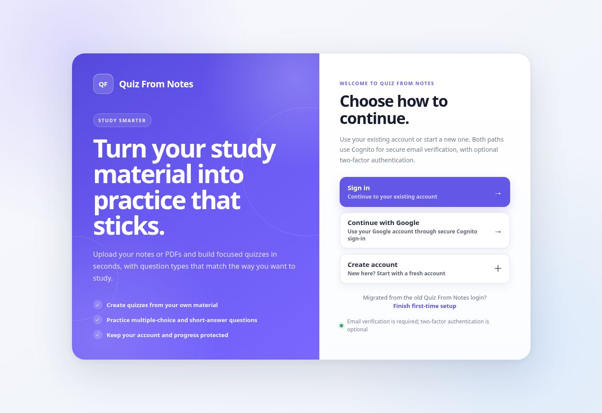

# Google sign-in production rollout

Updated 2026-10-13. Google federation and the Google-enabled frontend are deployed at https://quizfromnotes.com/.

## Exact running release

- Release/controller: `1bab85a588e2eb82f9f44d4b3f7ab7fcfa5ee405`.
- Reviewed application: `77a060cce504008a4479deacdc31279633d0fe4f` (combined PR #579).
- Reviewed application tree: `8016b2fce8056bd642bd615eef71eab106ae3800`.
- Prior retained rollback release: `27b4d377b30873330ca4ff521ffde517f03569ca`, which already includes the secure-linking backend and has Google disabled in its frontend.
- Registered native client activation remains pinned to the reviewed application. Its existing Cognito sign-in and cloud study flows are preserved.

## Production evidence

| Check | Run/evidence | Result |
| --- | --- | --- |
| Full Google-only Terraform review | 38447777343 | Exactly Google provider creation and browser-client update; no apply in this review |
| Backend-first promotion | 38450833234 | Fresh encrypted backup, HTTPS health, retained rollback, reminders and restored firewall |
| Live backend email/MFA study smoke | 38452070729 | Sign-in, MFA, deck/card creation and review persistence passed; synthetic data cleaned up |
| Guarded Google activation | 38452558923 | Fresh live-backend evidence, exact two-resource plan, provider/client postconditions; password sign-in preserved |
| Google-enabled immutable build | 38453422745 | Successful build against the verified live Google provider |
| Final release preflight | 38455211678 | Reviewed release prerequisites passed |
| Final production promotion | 38455883919 | Release and frontend switched; fresh backup, local HTTPS, rollback, reminders and restored firewall verified |
| Native study/cloud sync | 38453744712 | Native PKCE login, account/deck access, refresh, offline-review replay/conflict handling and sign-out passed; synthetic cleanup passed |
| Final browser study regression | 38457117315 | Email/MFA sign-in and study persistence passed against the final release; synthetic cleanup passed |
| Public Google entry | Agent browser, 2026-10-13 | Live Google button reaches Google's sign-in screen with the production Cognito redirect |

No model calls were used by these study canaries. Promotion reports confirm no AI-configuration or DNS changes.

## Remaining owner acceptance

Complete a real Google sign-in on production, including its return callback. If prompted, prove ownership of the existing **production** email/password account and its configured MFA before linking; confirm the existing quizzes remain available and persist after sign-out/sign-in. Staging account links and quiz data remain separate from production.

Real-provider Google new-account/linking/history tests were manually confirmed in isolated staging for the reviewed source. The agent verified the production provider, Google entry/redirect, email/MFA and native flows; it did not enter an owner's Google credentials or complete that final real-account callback.

## Maintenance boundaries

- Keep immutable release pins, native-client activation, fresh backup-before-switch, rollback and health checks.
- Standalone frontend repair is manual-only and shares the promotion/activation concurrency lock. A release-lock push must not publish a frontend.
- Production Terraform maintenance must explicitly preserve `enable_google_signin=true` and protected production OAuth credentials. The unconfigured module default remains false; a generic default-variable apply is not an approved production maintenance path.
- Google-only review/activation reconstructs the pinned original recovery ZIP and verifies it against the deployed digest. Changes to the recovery hook require separate review; do not ignore its code hash broadly.
- The permanent host retains `prevent_destroy` and ignores only later one-time bootstrap `user_data` changes. Use guarded host maintenance/deploy workflows.
- Keep staging credentials, pools, users, databases and callbacks isolated. Preserve the owner's manual staging Stop policy.
